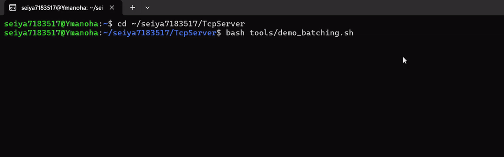

# Mini AI Inference Platform

C++ / Linux / Networking / Concurrency / CUDA / ONNX Runtime / TensorRT / Docker / Monitoring を段階的に積み上げ、
約1か月半(2026/09/25〜10/29)で「小さな AI 推論基盤」まで育てた学習・制作の記録です。

この方針は「ML Research ではなく **ML Systems**」。完成品だけでなく、**各 Phase で作り、測り、問題を見つけ、改善し、説明する**
までの過程そのものを成果物としています。各フォルダの README に、その日ごとの学びと測定を残しています。



*Phase 6〜8 の推論サーバー(Docker、GPU)に同じ負荷をかけ、動的バッチ化の有無だけを変えた。req/s が約 11 倍、遅延(p50)が 23.6 → 2.1 ms。*

- このリポジトリの履歴は、`TcpServer/`(Phase 2〜9)を作った記録です(36 コミット。コミットメッセージが Phase / Milestone 単位で並んでいます)。
- 計画の原本: [00_roadmap/統合ロードマップ.md](00_roadmap/統合ロードマップ.md)、進め方のルール: [00_roadmap/実行していくうえでのルール.md](00_roadmap/実行していくうえでのルール.md)

## 全体の流れ

| Phase | テーマ | 作ったもの | フォルダ |
|---|---|---|---|
| 1 | Modern C++ + Linux | **SystemProbe**: `/proc` から CPU・メモリ・プロセス・スレッド・ネットワーク・ディスクを取得する CLI | [phase1_SystemProbe](phase1_SystemProbe) |
| 2 | Networking | TCP echo server(single thread → multi thread → thread pool → epoll) | [TcpServer](TcpServer) |
| 3 | Concurrency / Performance | 同サーバーの高速化と測定 | 同上 |
| 4 | CUDA | vector add・行列積(naive / tiled)のベンチマーク | [phase4_CudaLearn](phase4_CudaLearn) |
| 5 | ML Inference | PyTorch → ONNX → ONNX Runtime(CPU / GPU)の比較 | [phase5_OnnxLearn](phase5_OnnxLearn) |
| 6 | Systems + ML | TCP サーバーに ONNX Runtime 推論を載せた `infer_server`(Request Queue・dynamic batching) | [TcpServer](TcpServer) |
| 7 | TensorRT / GPU | GPU 比較基盤、TensorRT(FP32 / FP16 / INT8)、C++ サーバーへの GPU 搭載 | 同上 |
| 8 | AI Infrastructure | Docker + NVIDIA Container Toolkit、`/metrics`、Prometheus + Grafana | 同上 |
| 9 | Distributed | 自作 L4 ロードバランサ `lb`、複数台構成の測定、Kubernetes(kind)の最小構成 | 同上 |

## 見どころ

- **過程が追える**: このリポジトリの git の履歴が、`TcpServer/`(Phase 2〜9)を作った過程そのものです。コミットメッセージが Phase / Milestone 単位で並んでいます。
- **測って語る**: 各 Phase の README に測定値と考察(なぜ速く/遅くなったか)を書いています。
- **理解の確認**: SystemProbe の README 末尾に、プロセス・仮想メモリ・fd・RAII を自分の言葉で説明したメモがあります(Phase 1 の完了条件)。

## フォルダ構成

```
MiniAIInferencePlatform/
├─ 00_roadmap/            計画・ルール・操作メモ
├─ phase1_SystemProbe/    完成版 + samples_phase1/(M0〜M5 の途中経過)
├─ TcpServer/             Phase 2〜9 の本体(推論サーバー、ロードバランサ、Docker、k8s)。README.md に記録
├─ phase4_CudaLearn/      CUDA ソース + README + 測定結果(2026/11/02 再測定)
└─ phase5_OnnxLearn/      PyTorch / ONNX の学習・推論・ベンチのスクリプトと README
```

## 含めていないもの(容量の都合。再生成できます)

- ビルド成果物(`build/`、実行ファイル)
- Python の `venv`、ONNX Runtime 配布パッケージ(`ort`、`ort_gpu`、`ort.tgz`)、MNIST データ
- 生成モデル(`TcpServer/models/`、`mlp.onnx.data` など)。`tools/export_mlp.py`、`export_onnx.py`、`export_mlp.py` で作れます。
- 再現手順は [TcpServer/README.md](TcpServer/README.md) の冒頭にあります。

## 既知の未整備

- `phase4_CudaLearn` の `vecheavy_bench` は、元の式が誤差を増幅するため K≥5 で CPU との結果検証が通らない(GPU のバグではない)。式を直した `vecheavy_stable.cu` で測り直し済み(詳細は同フォルダの README)。
